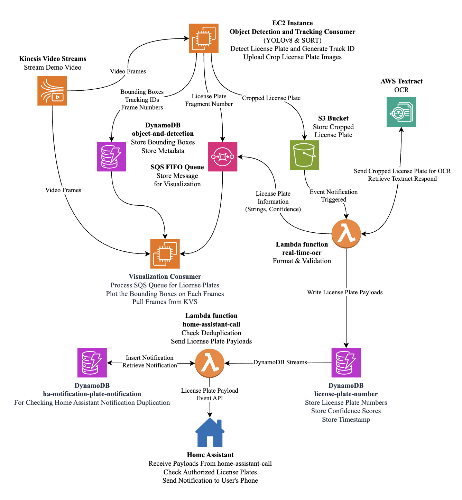
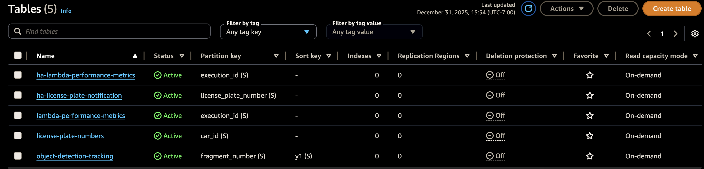
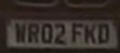
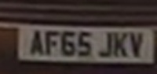
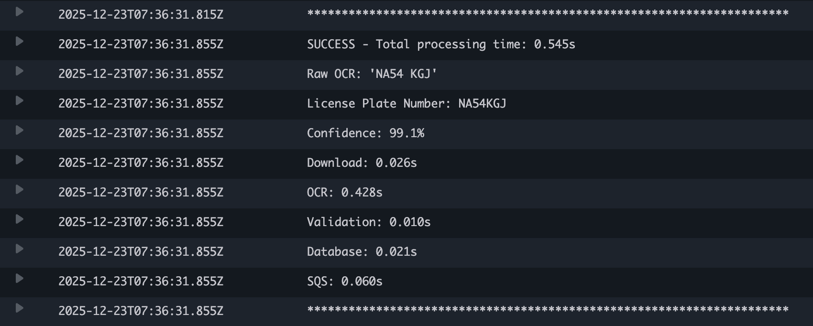
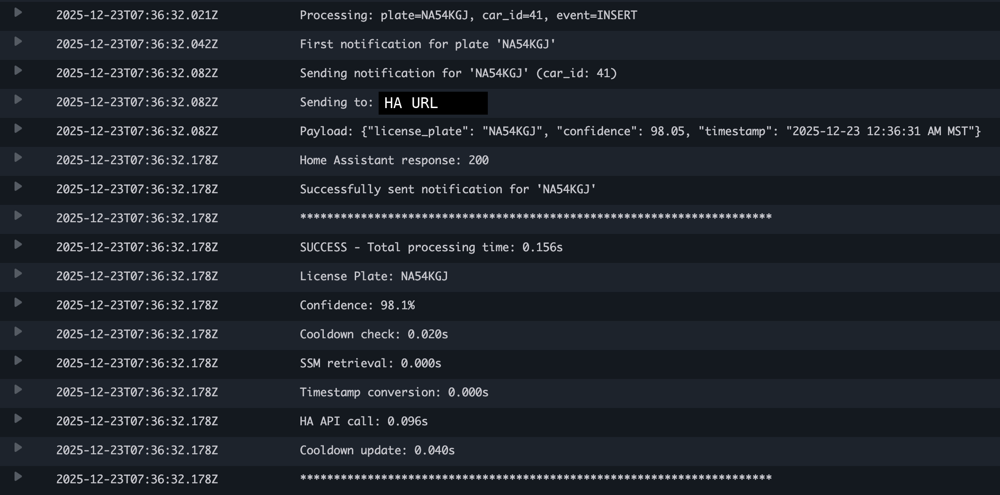
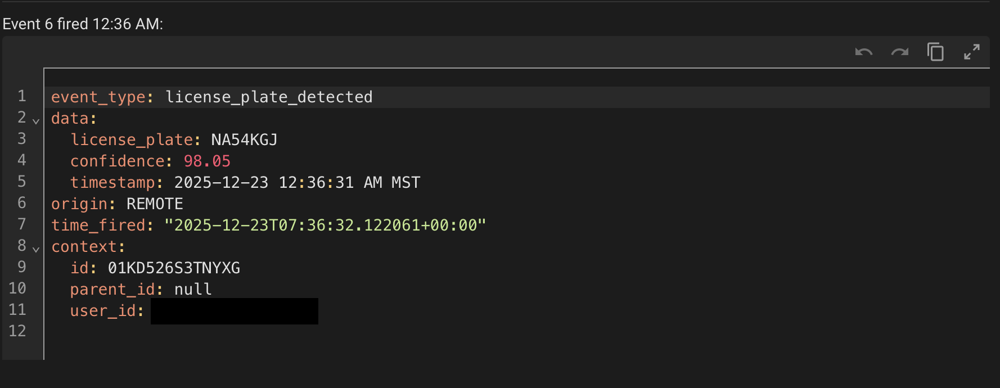
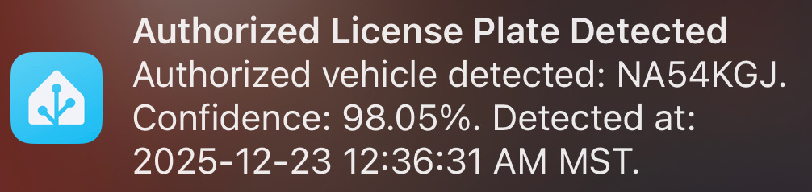
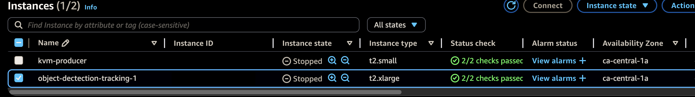

# AWS ANPR with Home Assistant automation

Real-time Automatic Number Plate Recognition (ANPR, also called license plate recognition) on Amazon Web Services, with notifications through Home Assistant.

A video stream is sent to Amazon Kinesis Video Streams. An Amazon Elastic Compute Cloud (EC2) instance detects and tracks license plates and uploads the best crops to Amazon S3. An AWS Lambda function reads each crop with Amazon Textract (Optical Character Recognition), validates the text, and a second Lambda function sends the result to Home Assistant, which notifies your phone.

## Project status and authorship

- The code and system design were written by the repository author with the help of AI assistants (Claude).
- The project is built on the open source Real-time Number Plate Recognition ANPR repository by Computer Vision Engineer (https://github.com/computervisioneng/real-time-number-plate-recognition-anpr). It provided the AWS pipeline design, the Kinesis Video Streams setup, YOLOv8 detection with SORT tracking, and basic Lambda functions.
- Added in this project: validation for several plate formats, OCR correction rules, a mix of synchronous and asynchronous Textract calls, notification deduplication with a time limit, the Home Assistant integration, the EasyOCR and frame filtering that avoids uploading incomplete plates, and better error handling.
- Code adapted from other projects is credited in the "Third-party code" and "Changes made to the Amazon example code" sections.
- The AWS resources used by this project have been deleted, so it is shared as a reference and will not run until you recreate them.

## Repository layout

| Folder | What is in it |
| --- | --- |
| `kvs/` | `stream.sh` streams a sample video into Kinesis Video Streams with GStreamer. |
| `object-detection-ec2/` | The consumer that reads the stream, detects plates (YOLOv8), tracks them (SORT), filters the crops, and uploads them. |
| `lambda/` | The AWS Lambda functions: `real-time-ocr-lambda.py` (Textract and plate validation with `util.py`), `home-assistant-call-lambda.py` (notification with cooldown), and `lambda_function_ha.py` (simple Simple Queue Service to webhook forwarder). |
| `home-assistant/` | Home Assistant sensors and automations (YAML). |
| `visualization-consumer/` | Draws the live overlay: pulls frames from the stream, reads the results, and plots the boxes and plates. |
| `metrics/` | Scripts that print timing results (Lambda step times and end-to-end latency). |
| `tests/` | `ocr-accuracy/` (accuracy check against manually labeled plates) and `insert-dydb.py` (inserts test plates to try the notification path). |
| `docs/` | Diagram and example output. |

## How the plate filtering works

`object-detection-ec2/kvs_consumer_library_example_object_detection_and_tracking.py` is adapted from an open source example. Added in this project:

- Each tracked plate is uploaded at most 3 times, and only after it has been seen for 8 frames.
- Crops that are too small are skipped.
- Blurry crops are skipped, using a sharpness and size quality score.
- Crops with no readable text are skipped, using a local EasyOCR check.

This keeps the number of Textract calls low.

## Changes made to the Amazon example code

The consumer scripts are adapted from a tutorial repository (https://github.com/computervisioneng/amazon-kinesis-video-streams-consumer-library-for-python), which is itself based on Amazon's example. The library code was not changed.

`visualization-consumer/kvs_consumer_library_example_visualization.py`:

- Stream check: it checks the stream status and lists the available streams at startup.
- Start point: it reads from 60 seconds ago instead of "NOW", and falls back to the earliest data if that fails.
- Frames: it saves every frame as a JPEG into `frames/` (the original handled every 5th frame and only logged its shape). It also writes a marker file per fragment so the plotting script knows the frames are ready.
- Configuration and messages: region, stream name and keys come from `.env`, and the idle message and sleep time are different.

`object-detection-ec2/kvs_consumer_library_example_object_detection_and_tracking.py`: the plate filtering described above, plus `requirements.txt` changes (EasyOCR added and a newer `av` version).

## Setup

1. Copy `.env.example` to `.env` and fill in your values.
2. Add the third-party code listed below. It is not included in this repository.
3. Install the dependencies from the `requirements.txt` files.
4. The loading animation in `visualization-consumer/optimized_plot.py` uses the frames in `visualization-consumer/loading_frames/`. The one minute sample video `kvs/sample_30fps_1440.mp4` is the one streamed by `kvs/stream.sh`.
5. Put the YOLO plate detection weights at the path used by the consumer script (`../license_plate_detector.pt`). The weights are not included.
6. Deploy the Lambda functions and set up the AWS resources (stream, S3 bucket, DynamoDB tables, Simple Queue Service queue) shown in the diagram.

## Third-party code (not included)

- Amazon Kinesis Video Streams Consumer Library for Python (MIT-0 license): https://github.com/aws-samples/amazon-kinesis-video-streams-consumer-library-for-python. Copy its `amazon_kinesis_video_consumer_library/` folder into both `object-detection-ec2/` and `visualization-consumer/`. This project used it unmodified. The consumer scripts here are adapted from its examples and keep the Amazon copyright header.
- SORT tracker by Alex Bewley (GNU General Public License version 3): https://github.com/abewley/sort. Copy its `sort/` folder into `object-detection-ec2/`. This project used it unmodified.
- Amazon Kinesis Video Streams C++ Producer SDK (Apache License 2.0): https://github.com/awslabs/amazon-kinesis-video-streams-producer-sdk-cpp. Needed to provide the `kvssink` GStreamer plugin used by `kvs/stream.sh`. This project used it unmodified.

## Example results

Two plate crops saved to S3 by the consumer:

 

Log of the OCR Lambda function reading a crop:

The Home Assistant Lambda function sending the notification (the Home Assistant URL is hidden):

The event received by Home Assistant:

The resulting phone notification:

The two EC2 instances used (instance IDs hidden):

## Results

Measured on a one minute demonstration video with 26 vehicles whose plates were fully visible. This is a single small test, so treat the numbers as indicative.

**From detection to notification**

| Stage | Count |
| --- | --- |
| Frames with a plate detected, without filtering | about 250 |
| Images uploaded to S3 after filtering | 67 (26.8%) |
| Images that passed OCR and validation | 57 (85.1% of uploads) |
| Unique plates sent to Home Assistant | 23 (88.5% of the 26 vehicles) |

**OCR accuracy** on 25 randomly chosen results, checked by hand: 24 exact matches (96%) and 1 partial match, where one character was misread (a low confidence result of 60.6%).

| Textract confidence | Samples | Correct | Accuracy |
| --- | --- | --- | --- |
| 90% or higher | 11 | 11 | 100% |
| 70% to 89% | 8 | 8 | 100% |
| Below 70% | 6 | 5 | 83.3% |

**Time from S3 upload to Home Assistant payload**: 1.95 seconds on average over 20 payloads. Three outliers above 5 seconds were excluded because they came from the 30 second cooldown, not from the pipeline.

| Latency | Payloads |
| --- | --- |
| Under 1 second | 1 (5%) |
| 1 to 2 seconds | 12 (60%) |
| 2 to 3 seconds | 6 (30%) |
| 3 to 5 seconds | 1 (5%) |

**OCR Lambda function** (average of 57 runs, 1.03 seconds in total)

| Step | Time (s) | Share |
| --- | --- | --- |
| S3 image download | 0.140 | 13.6% |
| Textract OCR | 0.738 | 71.7% |
| Formatting and validation | 0.002 | 0.2% |
| DynamoDB write | 0.054 | 5.3% |
| SQS publish | 0.063 | 6.1% |
| Other overhead | 0.032 | 3.1% |

**Home Assistant Lambda function** (average of the 23 payloads that were sent, 0.20 seconds in total). Of 59 runs, 36 (61%) were skipped by the 30 second cooldown, which avoids repeated notifications for the same vehicle.

| Step | Time (s) | Share |
| --- | --- | --- |
| DynamoDB cooldown check | 0.022 | 11.0% |
| Parameter retrieval | 0.021 | 10.7% |
| Timestamp conversion | 0.001 | 0.6% |
| Home Assistant API call | 0.115 | 57.5% |
| DynamoDB cooldown update | 0.041 | 20.5% |

## How the results were measured

- `tests/ocr-accuracy/` samples detections, downloads their images, and compares the OCR result to manually checked plates. On the 25 samples in `validation_results.csv`, 24 matched exactly and 1 was a partial match.
- `metrics/metric-ocr.py` and `metrics/metric-ha.py` print average Lambda step times.
- `metrics/end-to-end-latency.py` measures the time from S3 upload to the Home Assistant notification.

## License and credit

This project is released under the MIT License (see `LICENSE`). If you reuse any of this code, the license requires you to keep the copyright notice with it. Please also credit this repository by linking back to it.

The adapted Amazon example code keeps its own copyright header and MIT-0 license.
